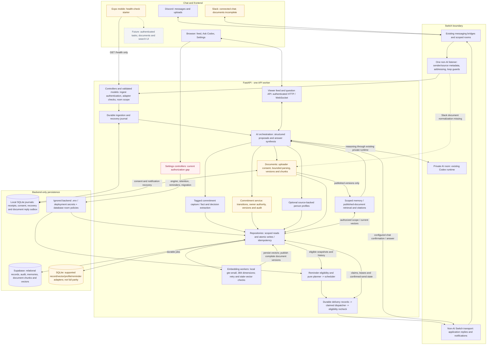
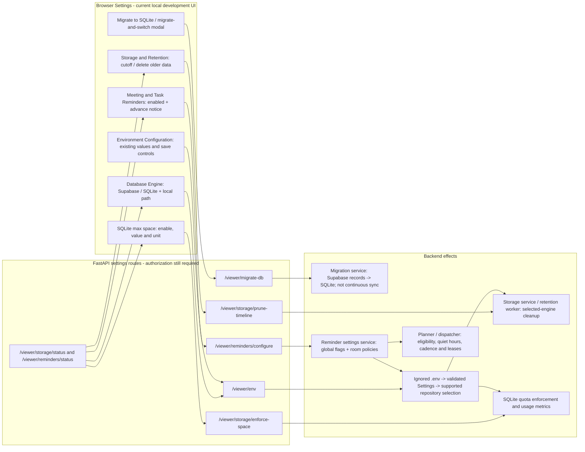

# Team Memory architecture

Based on the current [README](../README.md), [architecture](../architecture.md)
and inspected frontend/controller/service code. Solid arrows show implemented
relationships, not proof of hosted deployment. Dashed arrows show unfinished
integration. Amber means partial or gated; red marks a security gap.

[Open the standalone SVG diagram](team-memory-architecture.svg).

## Application and data pipeline

The repository box represents multiple adapters, not a universal engine switch:
document import/chat/embedding and lifecycle persistence still use Supabase.
General-memory and document-chunk embedding jobs are separate. Database source
messages are distinct from local processing journals. UI questions display their
answers in the viewer; only policy-approved chat work uses the outbound path.

## Frontend settings and the actions they control

Settings are controls for backend behavior, not a separate database/AI pipeline.
The current environment/settings/migration/storage handlers lack route-level
authorization; the diagram records that gap and does not endorse public exposure
or use of those handlers for secrets. Edit credentials directly in ignored local
configuration. Mobile currently has no equivalent settings interface. Quiet hours
and authority remain policy/service concerns, not fully implemented UI controls.

## Gates and completion boundaries

| Path | Required checks / current limit |
| --- | --- |
| Chat ingestion | Ingest credential, configured tenant/rooms, stable source identity, duplicate/self guards. |
| Tagged task creation | Supported addressing plus a clear personal promise; owner from sender metadata; no registration prerequisite. |
| Advanced actions | Trusted adapter, owner/role policy, eligible state, evidence, expected version, idempotency and atomic history. Manual human-auth routes remain closed. |
| Discord upload | Document adapter, exact allowed bridge/self participant, uploader-only consent, enabled room, bounded parser and document schema. PDF save reported; full cited retrieval unverified. |
| Document questions | Separate valid general adapter token; authorized published document scope. Current reported failure is adapter verification. |
| Slack documents | Platform-aware normalization, allow-list and chat scope integration unfinished in this checkout. |
| Reminders | Global planning/delivery gates, current room policy and eligible accepted task/deadline; supersede stale intentions and handle uncertain sends. |
| Storage | SQLite adapters cover selected modules. Supabase lifecycle/document functions and reviewed hosted deployment remain necessary. |

Future components: full authenticated mobile/web product screens, protected
preferences, document conflict detection and reviewed write-back, recording
controls and multi-workspace onboarding. These are not hidden behind completed
boxes in the application diagram.

The active fresh-install SQL is
[`20261104000100_initial_schema.sql`](../supabase/migrations/20261104000100_initial_schema.sql).
It resets tables and must never be replayed on existing hosted data. Remote schema
reconciliation needs separate review/approval. No services, schema or live messages
were changed to produce this diagram.
